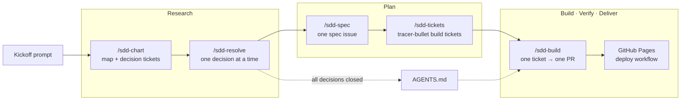
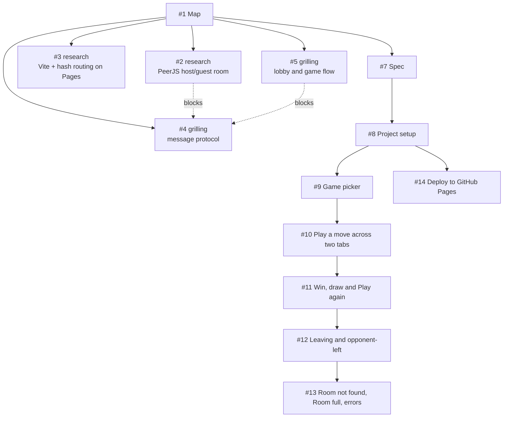

# Session guide: building an app with the cycle

This repository is the hands-on final session of **AI in the SDLC: Fundamentals** (the course repo is `ai-in-sdlc-fundamentals`). In one hour we take an idea to a deployed app, using the cycle the course teaches: research, plan, build, verify and review, deliver, inspect, adapt.

The app is online tic-tac-toe with friends. It's a static React site on GitHub Pages, and two browsers play peer-to-peer over PeerJS (WebRTC), with no backend of our own.

This guide explains how the session is set up, how the skills and the spec work, and which course slides each part puts into practice. Slide numbers refer to the introductory deck (`COURSE_OUTLINE.md` in the course repo).

> **Simplified on purpose.** The course describes a team working the cycle together over a Sprint. Here one person plays every role in one hour. The section [What we simplified](#what-we-simplified) lists what we left out and why.

---

## 1. The idea in one picture



Every arrow leaves something written on GitHub that the next step reads. This is slide 42's rule: *"Every step leaves something written that the next step reads."* Together, those artifacts are the audit trail: the intent, the decisions, the spec, the tickets, the diffs and the PRs.

---

## 2. Where things live

| Where | What | Course link |
|---|---|---|
| [GitHub Issues](https://github.com/bgustavocosta-m/sdd-demo-test/issues) | The plan: map, decision tickets, spec and build tickets, linked as sub-issues and "blocked by" edges | Slide 42: every step leaves something written |
| [`AGENTS.md`](AGENTS.md) | What every agent session needs: stack, commands, layout, the rules that are easy to get wrong, out of scope, working conventions | Slides 32, 33 and 39 |
| [`.claude/skills/`](.claude/skills/) | The `sdd` workflow: one router skill, five phase skills and shared conventions | Slide 35 (skills), slide 37 (workflows) |
| [`.claude/settings.json`](.claude/settings.json) | The allow-list of commands the agent may run without asking (`gh`, `git`, `npm`, `npx`, `node`) | Slide 38 (a safe agent run) |
| `.claude/settings.local.json` | The GitHub token for `gh`. **Gitignored**, never committed | Slide 21 (dev secrets are secrets) |
| `.claude/worktrees/` | One git worktree per ticket, so sessions work in isolation and in parallel. Gitignored | Slide 38 (isolate the run) |
| `src/` | The app. Pure logic in `src/game/` and `src/net/protocol.ts`, tested first; PeerJS wrappers in `src/net/`; pages in `src/pages/` | Slides 54 and 56 |
| [`.github/workflows/deploy.yml`](.github/workflows/deploy.yml) | Vite's official GitHub Pages workflow, which runs `npm test` before `npm run build` | Slide 62 (deliver) |

---

## 3. The kickoff prompt

Everything starts with one prompt to `/sdd-chart`. It follows slide 29 ("A strong prompt: from weak to strong"), with the same labelled sections and the same numbered tags for the five elements:

| Section | What we wrote | Slide 29 element |
|---|---|---|
| Goal and why | Play tic-tac-toe online with friends, static site, no backend. First version in a one-hour slot; checkers later. | Say why |
| Context (02) | Empty repo. React and PeerJS. Check the PeerJS docs instead of guessing. GitHub Pages needs a hash router. | 2. Context |
| Done when (01) | Game picker, create room with name and emoji, friend joins by link, synced board with win, draw and restart, rules unit-tested, build passes. | 1. Task and acceptance criteria |
| Limits (03) | Client-side only, no game libraries, two players, host is the source of truth. Not in scope: checkers gameplay, accounts, chat… | 3. Constraints and non-goals |
| Example (04) | Host gets `/#/tic-tac-toe/<room-id>` and plays ❌; friend opens the link and plays ⭕. | 4. Examples |
| How to work | List your questions and a short plan, then wait for my go-ahead. | The Interview pattern (slide 30) |
| Output and check (05) | Small commits, show test and build output, give a two-tab test recipe, say what you cut instead of rushing. | 5. Output shape |

"Done when" and "Limits" became the map's **Destination**, **Notes** and **Out of scope** almost word for word. A strong prompt is the first draft of the intent.

---

## 4. The skills

The workflow is **chart → resolve → spec → tickets → build**. It's written as skills (slide 35): folders with a `SKILL.md` that the agent loads only when the task needs it, so the context window stays lean (slide 31).

| Skill | File | What it does |
|---|---|---|
| `/sdd` | [`sdd/SKILL.md`](.claude/skills/sdd/SKILL.md) | The router. Reads the tracker, picks the next phase from a table, and loads **only** that phase's file |
| (shared) | [`sdd/conventions.md`](.claude/skills/sdd/conventions.md) | The issue graph, the `gh` commands, worktrees and the grilling format. Every phase reads it first |
| `/sdd-chart` | [`sdd-chart/SKILL.md`](.claude/skills/sdd-chart/SKILL.md) | Phase 1: turns the idea into a map and the decision tickets |
| `/sdd-resolve` | [`sdd-resolve/SKILL.md`](.claude/skills/sdd-resolve/SKILL.md) | Phase 2: settles one decision ticket; when the last one closes, drafts `AGENTS.md` |
| `/sdd-spec` | [`sdd-spec/SKILL.md`](.claude/skills/sdd-spec/SKILL.md) | Phase 3: collapses the map and the decisions into one spec |
| `/sdd-tickets` | [`sdd-tickets/SKILL.md`](.claude/skills/sdd-tickets/SKILL.md) | Phase 4: slices the spec into build tickets |
| `/sdd-build` | [`sdd-build/SKILL.md`](.claude/skills/sdd-build/SKILL.md) | Phase 5: builds one ticket in its own worktree and opens a PR |

Three design choices are worth pointing out:

- **GitHub is the state.** Each run does one phase (for resolve and build, one ticket), writes the outcome to GitHub and stops. The next run reads GitHub to find out where it is. A fresh session between runs loses nothing, which is slide 31's "reset when it drifts" made cheap: the context is on the tracker, not in the chat.
- **Human-triggered only.** Every skill has `disable-model-invocation: true`. The agent never decides on its own to move to the next phase; a person types the command. Each phase ends with "Stop." That's the human gate between steps (slides 44 and 46).
- **A workflow, not a free-roaming agent.** The phases are a fixed chain, close to slide 37's "prompt chaining" pattern: spec, then plan, then code, each step reading the last. Subagents are used in only one place (research), for a reason slide 37 lists.

### 4.1 `/sdd-chart` · Research

**Course step:** Research (slides 44 and 45). **Leaves:** the intent, written down.

1. **Grill the destination**: what we build, for whom, what "done" means at the end of the time box, what's out.
2. **Grill the frontier**, breadth-first: stack, architecture, each feature, networking, tests, deploy. Name the open decisions; don't settle them yet.
3. **Choose the tickets**: only the decisions the spec can't be written without. A one-hour POC gets 3 to 5. Each one is typed:
   - `sdd:research`: a fact outside the repo (a library's API, a service's limits). The agent finds it.
   - `sdd:grilling`: a choice only a person can make.
4. **Publish** the map and the tickets, wired as sub-issues and blocked-by edges.
5. **Fire research**: one background subagent per research ticket reads primary sources (official docs, source code), posts its findings with citations and closes the ticket.

Course links:

- **Grilling is the Interview pattern** (slide 30): the AI asks, the person answers. The format in `conventions.md` gives each question a recommendation, so the person decides quickly but still decides. *"Look facts up yourself; put only decisions to the user."*
- **The map is the intent** (slide 44): Destination = problem and outcome, Notes = constraints, Out of scope, and the open questions are the decision tickets.
- **Research subagents** match slide 37's reasons to add an agent: independent work in parallel, a clean context for noisy reading, and the lead's context stays focused.
- **Primary sources, with citations** answer pitfall E, "dependencies that don't exist", and slide 60's "check unfamiliar APIs against the installed version and the docs". That's why `AGENTS.md` pins `peerjs@1.5.5` and says to check the docs at that tag.

### 4.2 `/sdd-resolve` · Research → Plan

**Course step:** the end of Research and the start of Plan. **Leaves:** one closed ticket per decision, plus an updated map.

For each open ticket (grilling before research, since research subagents may still be running):

- `sdd:grilling`: grill on that ticket's question only, until the person confirms.
- `sdd:research`: summarise the subagent's findings in two lines for the person to accept.

The resolution comment has a fixed shape:

```markdown
## Decision
## Why
## Consequences for the spec
```

That's a small **Architecture Decision Record** (slide 39, after Nygard 2011): the decision, the reasoning and the consequences, kept next to the work. *"Read the ticket a rule comes from before changing that rule"* in `AGENTS.md` relies on this.

The map then gets one line per decision under **Decisions so far**, and anything the answer ruled out goes under **Out of scope**.

When the last decision closes, the skill **drafts `AGENTS.md`** from the decisions and opens a PR for it (PR #6). This is slides 32, 33 and 39: the instructions every session needs are written once and reviewed like code. Look at how it follows slide 33's rules:

- **Commands first**: `npm install`, `npm run dev`, `npm test`, `npm run build`.
- **A project map**: the Layout table.
- **Rules that are easy to get wrong**, each linked to the ticket it came from.
- **Boundaries**: the Out of scope list and "add nothing else without a decision ticket".
- **Short**: it points at the tickets for detail instead of repeating them (slide 31, "point, don't paste").

### 4.3 `/sdd-spec` · Plan

**Course step:** Plan, spec-driven development (slides 46, 48 and 49). **Leaves:** one `sdd:spec` issue.

This phase **doesn't ask anything**. Every decision is already made, so it only synthesises. Anything no ticket decided goes under **Assumptions**, stated as the default the agent picked, so the person can see and correct it.

How the spec template maps to slide 49's six fields of a minimal spec:

| Slide 49 field | Spec section (#7) |
|---|---|
| What it does | Problem, Solution (from the player's point of view) |
| Inputs, outputs and data shapes | Modules: each module's interface and whether it's pure, DOM or network |
| Acceptance criteria as scenarios | Solution steps 1 to 7, User stories; the build tickets turn them into checkboxes |
| Edge cases and failure modes | Decisions and Assumptions: room full, room not found, opponent left, out-of-turn moves, `unavailable-id` |
| Non-goals | Out of scope |
| Dependencies and constraints | Decisions, each linked to its ticket; Testing |

Of Böckeler's three levels (slide 48), this is **spec-first** with a lean towards **spec-anchored**: the spec and its decisions stay on GitHub, linked from `AGENTS.md`, after the work is done. Slide 48's caveat applies: a bad spec produces bad code, confidently. The person reads the spec and corrects it before slicing.

### 4.4 `/sdd-tickets` · Plan

**Course step:** Plan, "the plan: small tasks, in order, with the tests that prove each one" (slide 46). **Leaves:** `sdd:build` issues wired with blocked-by edges.

The skill slices the spec into **tracer bullets**: each ticket cuts through every layer (UI, logic, network, tests) and ends with something you can demo in a browser. The first slice is the thinnest end-to-end path; later slices widen it. Each one fits one agent session.

It shows the draft as a numbered list (title, blocked by, what a player can do once it's merged) and asks: right granularity? right edges? Nothing is published until the person approves. That's slide 46's gate: *"Nothing is implemented without an accepted plan."*

Every ticket body has **Parent** (the spec), **What to build**, **Acceptance criteria** as checkboxes, and **Implements** (which user stories and decisions it covers), so a session that never saw the conversation can build it (slide 46's check).

### 4.5 `/sdd-build` · Build, Verify, Deliver

**Course steps:** Build (slide 54), Verify and review (slides 56 and 60), Deliver (slide 62). **Leaves:** one PR per ticket.

1. **Pick** the named ticket, or the first open one with no open blocker and no assignee. Claim it.
2. **Read** the ticket, the spec and the decision tickets it cites.
3. **Open a fresh worktree** from `origin/main`.
4. **Build it.** Pure logic goes test-first: red, green, refactor.
5. **Verify** every acceptance criterion by running it: tests for logic, two browser tabs for anything networked.
6. **Open the PR**: `Closes #<n>`, then one line per criterion saying how it was checked, plus the `npm test` and `npm run build` output.
7. **Stop.** The person reviews and merges.

Course links:

- **One small task at a time** (slide 54): one ticket, one branch, one PR, small commits.
- **A safe agent run** (slide 38): isolated in a worktree, commands limited by the allow-list in `.claude/settings.json`, the plan (the ticket) approved before the run.
- **Prove it works** (slide 56): the agent runs the tests and the build before a person looks. Test-first means each test was seen failing, so it *can* fail. For the networked criteria, the agent drove two Playwright browser contexts over the public PeerJS broker and reported each check in the PR (see PR #18).
- **The review bar** (slide 60): the agent opens the PR but never merges it. A person who didn't write the code approves it.
- **Review capacity sets the pace** (slide 54): two sessions can build two unblocked tickets at once, but only while review keeps up.
- **Deliver** (slide 62): merging to `main` runs the deploy workflow, and `npm test` gates it. The merge is the production gate: the agent goes up to it, a person goes through it.

---

## 5. What the session produced

The issue graph, as it ended:



| Phase | Output |
|---|---|
| Chart | [Map (#1)](https://github.com/bgustavocosta-m/sdd-demo-test/issues/1) and four decision tickets: two research, two grilling |
| Resolve | [How does the PeerJS API support a host/guest room? (#2)](https://github.com/bgustavocosta-m/sdd-demo-test/issues/2), [How do Vite and React Router hash routing deploy to GitHub Pages? (#3)](https://github.com/bgustavocosta-m/sdd-demo-test/issues/3), [What is the message protocol between host and guest? (#4)](https://github.com/bgustavocosta-m/sdd-demo-test/issues/4), [How does the lobby and game flow look for host and guest? (#5)](https://github.com/bgustavocosta-m/sdd-demo-test/issues/5), and `AGENTS.md` (PR #6) |
| Spec | [Spec: online tic-tac-toe with friends (#7)](https://github.com/bgustavocosta-m/sdd-demo-test/issues/7) |
| Tickets | Seven build tickets, #8 to #14. #14 (deploy) only needs #8, so it could be built in parallel with the main chain |
| Build | PRs #15 to #21, one per ticket, each merged by a person |

Things worth showing in the room:

- **#4 is blocked by #2 and #5.** The protocol couldn't be decided before we knew what PeerJS offers and how the lobby flows. Blocked-by edges keep the order honest.
- **Research found what guessing would have missed.** `peer-unavailable` fires on the `peer`, not the `conn`; `send()` before `open` drops the message silently; `close` alone doesn't reliably tell you the other side left; React StrictMode's double mount causes `unavailable-id`. Each of these is now a line in `AGENTS.md`.
- **The commit history reads like the plan.** For example: `Rules: win lines, draw and restart, test-first`, then `Game over screen and Play again from either player`. Logic first, with its tests, then the UI on top.

---

## 6. Running it yourself

One-time setup:

1. A fine-grained GitHub token with Issues and Pull requests access to this repo only (least privilege, slide 21), in `.claude/settings.local.json` under `env.GH_TOKEN`. That file is gitignored. Check it stays that way.
2. In the repo settings, set **Pages → Source** to **GitHub Actions**. That's done by hand in the browser.

Then, in Claude Code:

```text
/sdd-chart <your kickoff prompt>     # once: map + decision tickets, research subagents start
/sdd-resolve                         # once per decision ticket; drafts AGENTS.md at the end
/sdd-spec                            # once: read the spec and correct it
/sdd-tickets                         # once: approve the slices before they're published
/sdd-build #<n>                      # once per ticket, then review and merge the PR
```

Or just type `/sdd` each time and let the router pick the phase from the tracker.

Starting a fresh session between runs is fine, and usually better. To check the app locally:

```sh
npm install
npm test
npm run build
npm run dev   # open two tabs: host in one, join from the other
```

---

## 7. Where each course step shows up

| Course step (slide 42) | In this session | Human gate |
|---|---|---|
| **Research** (44, 45) | `/sdd-chart` and `/sdd-resolve`: the map, research subagents, grilling | The person answers every grilling question and accepts the ticket list |
| **Plan** (46 to 49) | `/sdd-spec` and `/sdd-tickets`: spec, tracer-bullet tickets, `AGENTS.md` | The person corrects the spec and approves the slicing |
| **Build** (54, 55) | `/sdd-build`: one ticket, one worktree, test-first | The ticket is the approved plan for the run |
| **Verify and review** (56 to 61) | Tests and build in every PR; two-tab check; criteria ticked on the ticket | A person reviews and merges every PR |
| **Deliver** (62, 63) | Merge to `main` → deploy workflow, gated on `npm test` | The merge |
| **Inspect** (64 to 66) | Only informally: the two-tab check after deploy, and this guide's review | — |
| **Adapt** (67 to 69) | `AGENTS.md` grows from the decisions; the skills were edited during the work (commit `afd8ddf` added the `AGENTS.md` draft step to `/sdd-resolve`) | Changes to skills and `AGENTS.md` go through commits and PRs |

---

## 8. What we simplified

The time box is one hour, so some of the course's practices are cut. Name them in the session; they're the obvious next steps.

| The course says | What we did | Why, and what would close the gap |
|---|---|---|
| Every role takes part: product owner, designer, QA, specialists (slide 43) | One person played every role | Time. In a team, grilling questions would go to the role that owns them |
| Research and Plan are group work, in pairs and together (slides 45 and 47) | One person, one agent | Time. The `Decision / Why / Consequences` format is ready for a team to review |
| A separate reviewer that didn't write the code, against written review rules (slides 37, 56 and 61; Pocock) | The building agent verifies its own work; a person reviews | No review skill or `coding-standards.md` yet. Adding a reviewer subagent is the next step |
| Instructions advise, checks enforce (slide 38) | Rules live in `AGENTS.md`; only `npm test` gates the deploy | Branch protection and a required CI check on PRs would turn the main rules into checks |
| Test the agent setup like code (slide 69) | The skills and `AGENTS.md` aren't tested | Start with five real tasks from this session and rerun them when a skill changes |
| Inspect with signals and measure against a baseline (slides 64 and 70 to 72) | No metrics, no retrospective | No production traffic. A short retro on the PRs would feed Adapt |
| Small releases with a tested way back, behind a flag (slide 62) | Every merge deploys straight to Pages | A static demo; rollback is reverting the merge |
| Design inside Plan, with a throwaway prototype (slide 46) | No design step; plain CSS | The UI states are in the spec's Solution section instead |

---

## 9. Questions for the room

- Which grilling questions would you have answered differently, and who on your team should own them?
- Read `AGENTS.md`. What would you take out? What's missing that bit us during the build?
- Pick one PR. Could you defend it in review without the chat (slide 60)? What does its test prove?
- Which row of [What we simplified](#what-we-simplified) would you add first, and how would you check it works?
- Where would this workflow break on your team's codebase (slide 40)?
